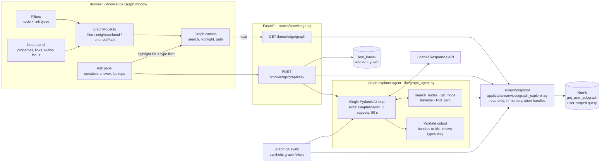

# Graph Explorer

The Knowledge Graph window is an explorer: filter by node and link type, search, isolate a node's
neighbourhood, find the path between two nodes, and ask an agent questions about the graph. This
page is the engineering reference for how it is built and why.

## Architecture



One request, end to end:

1. The window loads `GET /knowledge/graph`. The route asks the Neo4j adapter for the user's
   subgraph in one query and wraps it in a `GraphSnapshot`.
2. Manual exploration (type filters, search, N-hop neighbourhood, path between two nodes) runs in
   the browser on that data, in `frontend/src/components/knowledge/graphModel.ts`. No round trips.
3. A question goes to `POST /knowledge/graph/ask` with the selected node id and the last three
   question/answer pairs. The route builds a fresh snapshot and runs the agent against it.
4. The agent calls its tools as needed and returns a `GraphAnswer`: prose, node handles to
   highlight, and optionally node/link types to keep visible.
5. The route resolves handles back to node ids, drops anything that does not exist, saves a turn
   trace and returns. The window highlights the nodes and applies the filter.

## Where things live

| Piece | File |
|-------|------|
| Snapshot: search, traversal, paths, handles | `src/agent_system/application/services/graph_explorer.py` |
| Agent, tools, prompt, run loop | `src/agent_system/adapters/outbound/llm/graph_agent.py` |
| User-scoped graph query | `Neo4jAdapter.get_user_subgraph` / `_USER_SCOPE` in `adapters/outbound/graph/neo4j_adapter.py` |
| HTTP routes | `src/agent_system/adapters/inbound/api/routes/knowledge.py` |
| Explorer window | `frontend/src/components/knowledge/KnowledgeGraph.tsx` |
| Client-side graph operations | `frontend/src/components/knowledge/graphModel.ts` |
| Ask / Filters / Node panels | `GraphAskPanel.tsx`, `GraphFilters.tsx`, `NodeDetails.tsx` |
| Evals | `src/agent_system/evals/graph_qa.py`, `evals/graph_fixtures/graph_qa.yaml` |
| Unit tests | `tests/unit/graph/test_graph_explorer.py` |
| Local demo data | `scripts/seed_graph_demo.py` |

## The agent's tools

| Tool | Use | Returns |
|------|-----|---------|
| `search_nodes(query, node_types, limit)` | Find a node by name or stored details; empty query lists a type | Ranked matches with handle, type, label, link count, top properties |
| `get_node(node)` | Open one node | All properties and every link, up to 25 |
| `traverse(start, depth, edge_types, node_types, direction, limit)` | What is reachable within 1-3 hops | Nodes with hop distance and the link that reached them |
| `find_path(source, target, max_hops)` | How two nodes are connected | The shortest chain, preferring one that avoids the owner's node |

All four are read-only and operate on the snapshot, never on Neo4j directly. The agent cannot write
Cypher. Results are capped, and when a cap is hit the result says how many were left out and how to
narrow the call. Errors say what to do next ("No node with handle 'n99'. Use search_nodes...").

## Design decisions

These follow the current agent-building guidance from Anthropic (building effective agents,
context engineering, writing tools for agents) and OpenAI (practical guide to building agents,
agent safety). Each row is a recommendation and what it turned into here.

| Recommendation | What the explorer does |
|----------------|------------------------|
| Start with the simplest thing that works; add agents only when the workload calls for it | One agent with one loop. No planner, router or sub-agents. Filtering, neighbourhoods and paths in the UI are plain code with no model call at all. |
| Treat context as scarce; retrieve just in time | The prompt carries a schema-level summary only: type counts, the owner's node, the six best-connected nodes, the current selection. Node contents are fetched through tools by handle. |
| Lightweight identifiers | Nodes are `n1`, `n2`, ... instead of 36-character UUIDs. Handles are stable for a snapshot and resolve back to real ids on the server. |
| Fewer, better tools that match how the task divides | Four tools: find, open, walk, connect. Counting questions need none; the summary answers them. |
| Tools return high-signal output | Compact one-line-per-node text, capped, with "N more, narrow with ..." hints. Internal fields and embeddings are stripped; long values are clipped. |
| Prompt-engineer the tool descriptions | Each docstring says when to use the tool, gives example arguments, and names the limits. |
| A simple loop with explicit exits | The run ends on a structured `GraphAnswer`, on `GRAPH_AGENT_MAX_REQUESTS` model calls (default 8), or after `GRAPH_AGENT_TIMEOUT_S` (default 90). Limit and timeout exits return what was found so far with `stopped` set, not an error. |
| Untrusted data never drives behaviour | Graph text comes from conversations and web pages. Tools cannot write, labels are JSON-quoted in tool output, and the prompt says stored text is content, not instructions. |
| Pass only validated structured fields between steps | Besides prose, only node handles and type names leave the agent. Unknown handles are dropped; a filter with any unknown type is rejected whole. The UI renders the answer as markdown with images disabled. |
| Limit the access you grant | The snapshot holds one user's data. `_USER_SCOPE` never walks through shared tool nodes or nodes owned by another user. |
| Evals and tracing from day one | `graph-qa` evals with deterministic checks, unit tests on a scripted model, and a turn trace per question (tool calls, tokens, cost, latency) in `turn_traces` with `source = graph`. |

## Evals

```bash
python -m agent_system.evals graph-qa                 # all cases against the synthetic graph
python -m agent_system.evals graph-qa --repeats 3 --fail-under 0.9
python -m agent_system.evals graph-qa --case path_multi_hop --verbose
make eval-graph
```

The suite needs an OpenAI key (`EVAL_OPENAI_API_KEY` or `OPENAI_API_KEY`) and nothing else: no
database, no Neo4j. Cases cover lookup, one- and two-hop traversal, paths, view filtering, the
selected node, a question the graph cannot answer, and a node whose label contains an injected
instruction. Checks are deterministic: required and forbidden strings in the answer, required
highlighted nodes, tools used, a tool-call budget, and the returned filter.

## Configuration

| Variable | Default | Meaning |
|----------|---------|---------|
| `GRAPH_AGENT_MODEL` | `DEFAULT_MODEL` | Model for the explorer agent |
| `GRAPH_AGENT_MAX_REQUESTS` | `8` | Hard cap on model calls per question |
| `GRAPH_AGENT_TIMEOUT_S` | `90` | Wall-clock limit per question |

## API

```bash
# Ask a question
curl -X POST http://localhost:8000/api/v1/knowledge/graph/ask \
  -H "Authorization: Bearer <token>" -H "Content-Type: application/json" \
  -d '{"question": "Which places do the people I know go to?", "selected_node_id": null, "history": []}'
```

```json
{
  "answer": "- **June Alvarez** frequents **Blue Door Coffee** ...",
  "highlight_node_ids": ["<node id>", "..."],
  "filter": null,
  "steps": [{"tool": "traverse", "args": {"start": "n22", "edge_types": ["KNOWS"]}, "summary": "3 node(s) within 1 hop(s) ...", "duration_ms": 0.2}],
  "stopped": "answered",
  "usage": {"requests": 5, "input_tokens": 4874, "output_tokens": 194, "duration_ms": 10781.0, "cost_usd": null}
}
```

`stopped` is one of `answered`, `step_limit`, `timeout`, `error`. `filter` is
`{"node_types": [...], "edge_types": [...]}` when the user asked to narrow the view.

## Local demo data

```bash
make neo4j                                   # or: docker start neo4j
python scripts/seed_graph_demo.py            # creates graph-demo@example.com, prints its password
```

The script also seeds a second user who shares a tool node with the first and reports whether any
of that user's nodes are visible to the demo user (they should not be).
