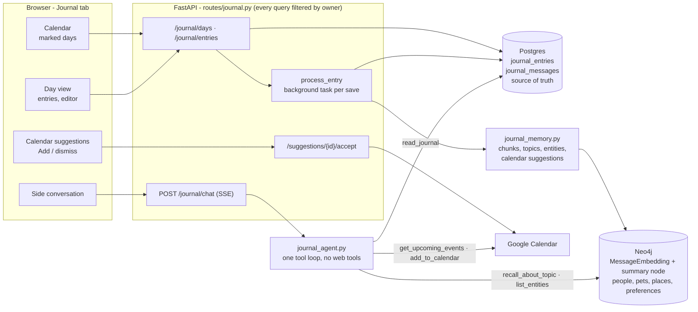

# Journal

The Journal tab is a dated, private journal. You write entries, a calendar shows which days have
writing, and a side conversation lets you talk a day over with an agent that knows what you wrote,
what it remembers about you, and your calendar. Entries feed the same memory that chat uses, so a
later chat can draw on them. This page is the engineering reference for how it is built and why.

## Architecture



## Decisions and their trade-offs

**Postgres is the source of truth; the graph and the vectors are a derived copy.** An entry is a
row in `journal_entries`. Saving returns as soon as the row is committed; a background task then
writes memory. The alternative, storing entries only as graph nodes or as a special kind of
conversation, would have made the calendar a graph query and tied the journal to whatever the chat
engines do with conversations. The cost of the split is that the two can disagree for a few
seconds, or longer if a model call fails, so each entry carries a `memory_status` (`pending`,
`done`, `failed`, `skipped`) and the UI offers a retry. Writing is never lost because memory failed.

**New tables, no new columns.** There is no migration tool, so `journal_entries` and
`journal_messages` are created by `Base.metadata.create_all` at startup. Nothing existing changed
shape.

**Several entries per day, plus a side conversation.** A day holds any number of timestamped
entries. The agent's replies live in `journal_messages` and are never treated as journal text or
fed to memory: only what you save as an entry is. This keeps your words separate from the model's,
which matters both for re-reading and for memory quality (the chat pipeline learned the same
lesson: facts are extracted from the user's words only).

**The day is decided once, in your timezone.** `entry_date` is a plain `YYYY-MM-DD` string taken
from the timezone setting at the moment of writing (or the day picked in the calendar when
back-filling). It is not recomputed from a timestamp, so changing the timezone setting later, or
travelling, does not move old entries to a different day. The browser does date arithmetic on
those strings in UTC for the same reason. Days after tomorrow are refused: a journal records.

**Edit and delete are allowed; facts stay.** An entry's embeddings and its summary node are filed
under the key `journal:<entry id>`. An edit deletes and rebuilds them; a delete removes them. The
people, pets, places, preferences and topic nodes extracted from an entry are merged into the
user's graph with no pointer back to one source, exactly as chat does, so they remain after a
delete and can be removed in the graph explorer. Tracking provenance for every fact would be more
correct but means changing how every graph write works, for chat as well. The delete confirmation
says this in plain words.

**The calendar is only changed on a click or a request.** After a save, one model call looks for
definite future plans in the entry and stores them on the row as suggestions. Nothing is sent to
Google Calendar until you press "Add to calendar" (or ask the agent in the side conversation).
Suggestions are only looked for when a calendar is connected and the entry is dated today or
yesterday, since a back-filled entry talks about a Friday long gone. Accepting twice adds once.

**A separate agent with no web tools.** `journal_agent.py` is its own tool loop with five tools:
`read_journal`, `recall_about_topic`, `list_entities`, `get_upcoming_events`, `add_to_calendar`.
Four of them are the chat loop's tool functions registered on a second agent, so there is one
implementation. It has no `web_search` or `read_webpage`. The chat loop needs a run-time guard so
web text and a calendar write never share a turn; here the same property holds because web text
cannot enter a journal turn at all. The journal does not depend on `CHAT_ENGINE`, so switching the
chat engine never changes it. Exits are the same as the chat loop's: an answer, the request cap
(`CHAT_LOOP_MAX_REQUESTS`), or the timeout (`CHAT_LOOP_TIMEOUT_S`).

**The side conversation is a POST stream.** The browser reads `POST /journal/chat` with `fetch`
instead of `EventSource`, so the message and the token travel in the body and a header rather than
in a URL that could end up in logs. It fits the page's CSP (`connect-src 'self'`).

## What reaches memory

For each saved entry, `remember_entry` writes, all stamped with the owner's `user_id`:

| What | Where | Removed on delete |
| --- | --- | --- |
| One embedding per ~1500 characters, text prefixed `[Journal entry, <day>]` | `MessageEmbedding`, `conversation_id = journal:<id>` | yes |
| A summary node linked to the entry's topics | `KnowledgeNode` (`interaction`) | yes |
| Topics and facts | `KnowledgeNode` (`topic`) | no |
| People, pets, places, preferences, links | `PersonNode`, `PetNode`, `LocationNode`, `PreferenceNode` | no |

The `[Journal entry, <day>]` prefix is stored with the text, so when chat recalls it the model can
say where and when it came from. Entry text is the user's own words and is trusted for memory;
this is the opposite of web text, which is never written to memory.

## Access control

Every route takes the user from the token (validated with a live account lookup) and every
repository method puts `user_id` in its `WHERE` clause. Another user's entry returns 404, the same
as a missing one. In the graph, journal nodes carry their owner and the one new graph method,
`delete_conversation_memory`, matches on `user_id` as well as the key.

## Known limits

- Background memory work runs in the API process. A restart in the middle of it leaves the entry
  `pending`; the retry link, or any edit, rebuilds it. There is no queue.
- The per-entry lock that orders memory writes is in-process, so it assumes one backend replica.
- Facts learned from a deleted entry stay in the graph (see above).
- The side conversation is not memorised. To make something part of memory, save it as an entry.
- Journal entries do not update the short "stored notes" list that the chat prompt carries; they
  are reached through recall tools.

## Verifying

```bash
# routes, ownership, the background task (no model or network)
.venv/bin/python -m pytest tests/e2e/api/test_journal_api.py tests/unit/journal
# two users in a real Neo4j: recall, vector search, delete (needs Docker)
.venv/bin/python -m pytest tests/integration/adapters/test_journal_memory_isolation.py
```
