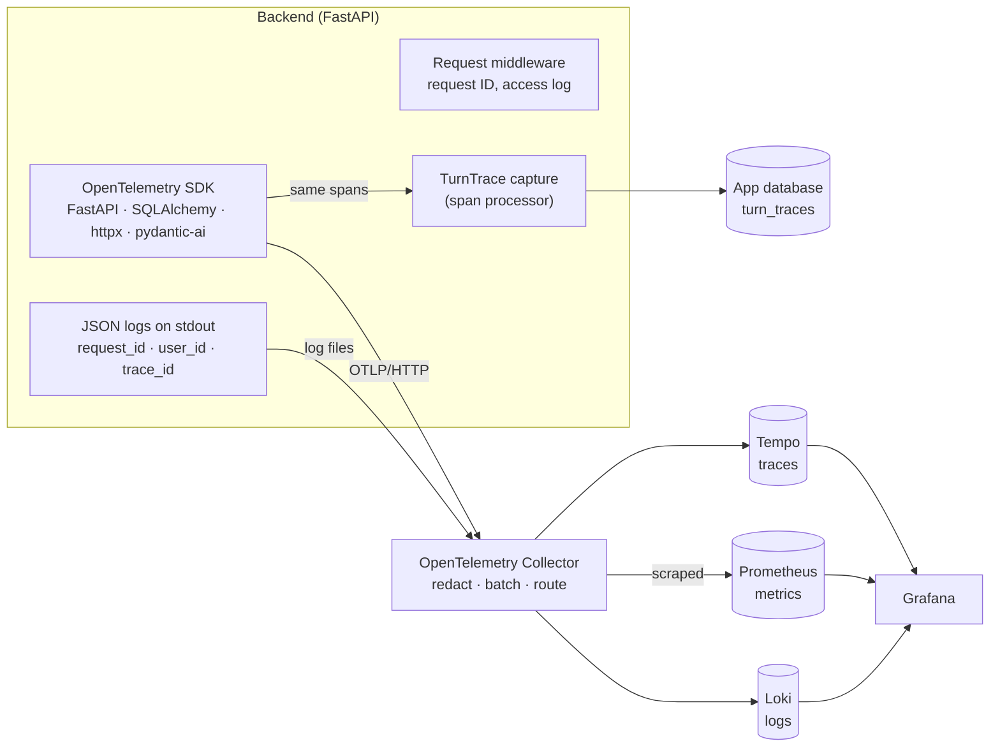

# Observability

How the app reports what it is doing, and why it is built this way.

## What runs where

| | Production (AKS) | Local |
|---|---|---|
| Request IDs, JSON logs, access log | yes | yes (`LOG_FORMAT=json`) |
| Readiness check (`/health/ready`) | yes | yes |
| OpenTelemetry traces and metrics | **off** (no endpoint configured) | on, when `OTEL_EXPORTER_OTLP_ENDPOINT` is set |
| Collector, Prometheus, Tempo, Loki, Grafana | not installed | `infra/observability/docker-compose.yml` |

Production has no telemetry backend on purpose; see [Why the stack is not in the cluster](#why-the-stack-is-not-in-the-cluster).

## Architecture



Three signals, each answering a different question:

- **Metrics** (Prometheus): *is something wrong, and how much?* Cheap, aggregated, good for dashboards and alerts.
- **Traces** (Tempo): *where did this one request spend its time, and what did it call?* One tree per request: HTTP span → SQL statements → agent run → model calls → tool calls.
- **Logs** (Loki): *what exactly happened?* The detail, found by request ID or trace ID.

They are joined by IDs: a metric spike leads to a slow trace, the trace's ID finds its log lines, and a log line's `trace_id` leads back to the trace.

## The pieces

| Piece | File | What it does |
|---|---|---|
| Request context | `src/agent_system/adapters/inbound/api/observability.py` | Request ID per request, access log, JSON formatter, log filter that stamps every line |
| Export | `src/agent_system/adapters/outbound/telemetry/otel.py` | Tracer and meter providers, OTLP exporters, auto-instrumentation. Off without an endpoint |
| LLM capture | `src/agent_system/adapters/outbound/telemetry/trace.py` | Span processor that copies model calls into the per-turn trace shown in the Evals tab |
| Health | `src/agent_system/adapters/inbound/api/main.py` | `/health` (liveness), `/health/ready` (readiness) |
| Collector pipeline | `infra/observability/otel-collector.yaml` | Receives OTLP and log files; redacts; routes to Tempo, Prometheus, Loki |
| Dashboard | `infra/observability/grafana/dashboards/overview.json` | Rate, errors, latency, refusals, tokens, agent turns, recent warnings |

## Run it locally

```bash
docker compose -f infra/observability/docker-compose.yml up -d
OTEL_EXPORTER_OTLP_ENDPOINT=http://localhost:4318 LOG_FORMAT=json make backend 2>&1 | tee infra/observability/logs/backend.log
```

Grafana is at http://localhost:3000 (no login locally). The dashboard is *Agent System: overview*. In **Explore**:

- Tempo: paste a `trace_id` from any log line.
- Loki: `{service_name="agent-system-backend"} | status >= 400`
- Prometheus: `sum(rate(http_server_duration_milliseconds_count[5m])) by (http_target, http_status_code)`

Without the stack, production logs answer the same questions with `jq`:

```bash
# every refused request in the last hour
kubectl logs deploy/agent-system-backend -n agent-system --since=1h | jq -c 'select(.status == 401 or .status == 403 or .status == 429)'
# everything that happened in one request
kubectl logs deploy/agent-system-backend -n agent-system --since=1h | jq -c 'select(.request_id == "<id from the X-Request-ID header>")'
```

## Configuration

| Variable | Default | Meaning |
|---|---|---|
| `LOG_FORMAT` | `auto` | `json`, `text`, or `auto` (JSON when deployed) |
| `OTEL_EXPORTER_OTLP_ENDPOINT` | unset | Collector's OTLP/HTTP address. Unset means no export |
| `APP_ENV` | `development` | `production` is implied when running in Kubernetes |

## Design decisions

### Why does the app only know "an OTLP endpoint"?

The app emits telemetry in one vendor-neutral format and has no idea where it ends up. The Collector decides: which backend, what to drop, what to sample. Three consequences:

- **Changing backend is a config change, not a code change.** Tempo today, Datadog or Grafana Cloud tomorrow, by editing an exporter in `otel-collector.yaml`. The service is not rebuilt.
- **Policy lives in one place.** Redaction and sampling apply to every service that sends to the Collector, instead of being re-implemented in each.
- **The app is protected from the backend.** The SDK hands spans to a batch processor and returns; if Tempo is slow or down, the Collector buffers or drops, and request latency is unaffected.

The cost is one more thing to run and one more hop.

### How do a request ID, a trace ID and a log line tie together?

- The **request ID** is created by our middleware (or accepted from `X-Request-ID` if it is short and plain). It is returned to the client in the response header and in the body of a 500. It is the ID a *person* quotes: "it failed, request `ab12…`".
- The **trace ID** is created by OpenTelemetry when the server span starts. It is the ID the *tools* use, and with W3C `traceparent` headers it would follow the request into other services.
- A logging filter stamps **every log line** written during the request with both, plus the user ID once the token is checked. It reads them from a context variable, so no function has to pass them along. Background tasks started by a request inherit the context, so their lines carry the same IDs.
- The request ID is also set as a span attribute (`app.request_id`), so a support-style lookup by request ID finds the trace too.

Without tracing configured (production today), the request ID alone does the correlation.

### Why strip prompts in the Collector and not in the app?

Prompts, model output and tool payloads are user content and should not sit in a general-purpose tracing backend that more people and tools can read. But the app itself *needs* that content in-process: the span processor that builds the Evals-tab trace reads it from the same spans. So:

- pydantic-ai keeps recording content on spans;
- the in-app capture reads it and stores a clipped copy in the app database, behind the admin-only Evals routes;
- the Collector's `attributes/drop_llm_content` processor deletes those attributes before anything is exported.

Doing it in the Collector also means the rule is enforced regardless of what any one service forgets, and can be tightened without a deploy. The trade-off: content does travel from the app to the Collector, so that hop must stay inside the cluster. The same pipeline removes query strings from outbound URLs, which can hold search terms and API keys.

### Why does readiness check Postgres but only report Neo4j?

Liveness and readiness trigger different actions, so they must test different things:

- **Liveness** (`/health`) failing makes Kubernetes *restart the pod*. A restart cannot fix a database that is down, so liveness checks nothing but "the process answers". Tying it to a dependency turns a database blip into a restart loop.
- **Readiness** (`/health/ready`) failing *takes the pod out of the load balancer*. That is right when the pod cannot do useful work: without Postgres nobody can even sign in.

Neo4j is different in kind: chat degrades without the knowledge graph but still works, and so does everything else. With a single replica, failing readiness on Neo4j would turn a partial outage into a total one. So it is reported in the response body (and logged as `dependency_down`) for humans and alerts, but does not change the status code. Each probe has a 2-second deadline so a hung dependency cannot hang the health check.

### Why is user ID on traces and logs but not a metric label?

Cost scales differently:

- A **metric** is stored as one time series per unique combination of label values. Labels must come from small fixed sets (route template, status code, model name, turn outcome). A label with one value per user multiplies every series by the number of users; this is the classic way to exhaust a Prometheus server's memory. It is why the route label is `/conversations/{conversation_id}` and never the raw path.
- A **trace** or **log line** is stored once per event. An extra field on it costs a few bytes and nothing else, so high-cardinality values (user ID, request ID, conversation ID) belong there.

So the workflow is: metrics say *that* something is wrong and for which route; traces and logs say *for whom*.

## Other decisions worth knowing

- **Sampling.** Everything is kept: traffic is tiny. At volume the Collector would do *tail* sampling (decide after the trace is complete: keep all errors and slow traces, a percentage of the rest). Head sampling in the SDK is cheaper but decides before knowing whether the request was interesting. Agent traces are long, which makes this matter sooner than for a CRUD API.
- **Logs are not sent over OTLP.** They stay JSON on stdout, the Kubernetes convention: the app does not depend on a log backend being up, and `kubectl logs` always works.
- **The access log skips successful health probes** (they arrive every few seconds) but logs failed ones.
- **Refusals are warnings.** 401, 403 and 429 log at WARNING and have their own dashboard panel: they are the security-relevant events.
- **No emails in logs.** Lines identify users by ID.
- **Pure ASGI middleware**, not `BaseHTTPMiddleware`, so streaming responses and WebSockets pass through unbuffered.
- **One tracer provider.** The LLM capture and the exporter share it, so agent spans are children of the HTTP span rather than a separate trace.

## What to alert on (if a backend is added)

- Server error ratio above 1% for 10 minutes.
- p95 latency of non-streaming routes above a threshold.
- `/health/ready` failing, or `dependency_down` log events.
- A sharp rise in refused requests (credential stuffing, or a broken client).
- Token spend per hour above a budget.
- Agent turns ending in `error`, `timeout` or `step_limit` above a small share.

## Why the stack is not in the cluster

Measured in November 2026: the cluster is two `Standard_B2s` nodes with about 2.8 GB of allocatable memory each, at 62% and 76% in use (Neo4j alone reserves 2 GB). A Prometheus + Loki + Tempo + Grafana + Collector stack was estimated at 1.7–2 GB under real load, which does not fit without risking eviction of the app.

Options considered:

| Option | Cost | Outcome |
|---|---|---|
| Dedicated 8 GB monitoring node pool (`Standard_B2as_v2`), tainted | about $62/month plus disks | Right layout; not worth it for a personal app |
| Third `B2s` node | about $36/month plus disks | Fits only with tight limits and short retention |
| Collector in-cluster, Grafana Cloud free tier as backend | $0 | Same pipeline; telemetry leaves Azure. The fallback if production telemetry is wanted |
| Stack local only, structured logs in production | $0 | **Chosen** |

A node pool can be created for a few days and deleted if a live production demo is ever needed.
