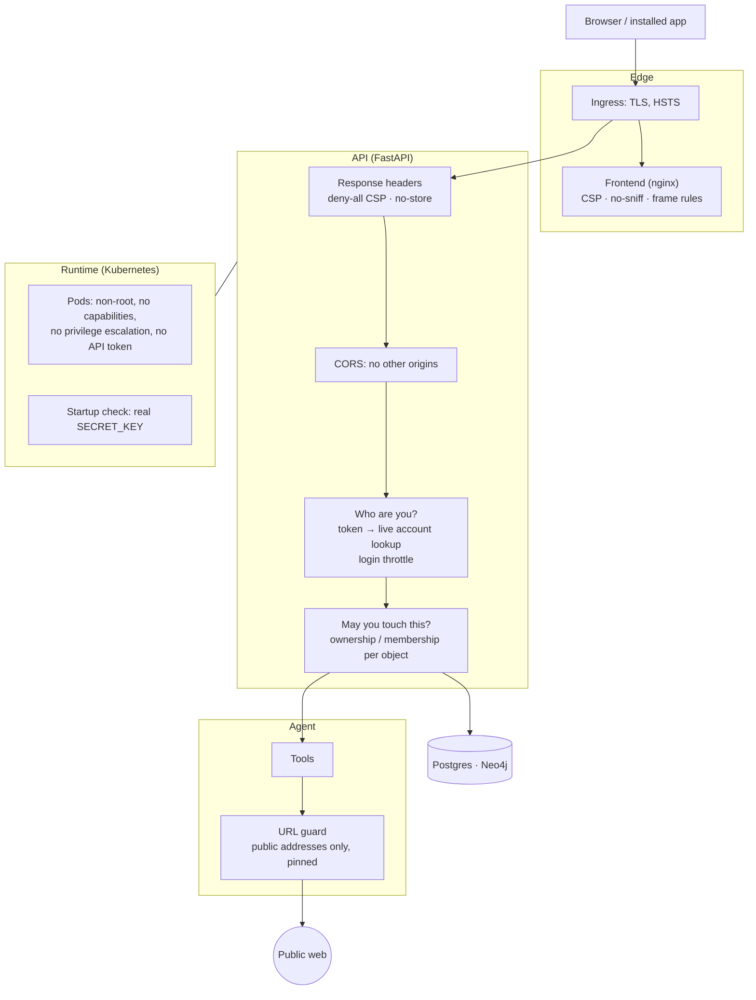

# Security

What protects the app, what was wrong before, and what is still open. Written after a security pass in November 2026; each section says what the gap was, because the gaps are the instructive part.

## The layers



No single layer is trusted to be enough. The clearest example is the web reader: the URL guard stops a hostile URL being fetched, the pod's lack of an API token and capabilities limits what a fetch could reach if it got through, and the browser's CSP stops a hostile response being rendered or exfiltrating data.

## Access control: who may touch what

Authentication answers *who is calling*. Authorization answers *may they touch this particular object*. The app did the first and, in several places, skipped the second. That class of bug is called **broken object-level authorization** (or IDOR): the endpoint checks that you are logged in, then acts on whatever ID you supply.

| Was | Now |
|---|---|
| Group chat WebSocket trusted a `user_id` query parameter; no token at all | The user is whoever the access token says. The URL is not consulted |
| `require_conversation_access` and `require_plan_access` checked only that the object existed (the ownership check was a TODO) | Owner must match; otherwise 404 |
| `/agent/chat` would continue any conversation ID | Same ownership check before the turn starts |
| Five `/tools` routes needed no login, including a web search | Every `/tools` route requires a signed-in user |
| Calendar sync accepted any event ID | Caller must be a member of the event's group |

Decisions:

- **404, not 403, for someone else's object.** A 403 confirms the ID exists; a 404 is indistinguishable from "no such thing", so IDs cannot be probed.
- **WebSocket auth by subprotocol.** Browsers cannot set an `Authorization` header on a WebSocket. The common workaround, a token in the query string, puts it in access logs and browser history. Instead the client offers two subprotocols, `bearer` and the token (`new WebSocket(url, ['bearer', token])`), and the server echoes `bearer`.
- **Check close to the data.** Ownership is enforced in the dependency every conversation and plan route already calls, so a new route gets it by default.

Tests: `tests/e2e/api/test_access_control.py` uses two unrelated users and asks, for each route, whether the second can reach what belongs to the first.

## Authentication: tokens, logins, keys

**Tokens follow the account.** A JWT's signature proves only that it was issued at some point in the last 30 days. The app used to trust its contents, including `is_superuser`, until expiry: a deactivated user, or a demoted admin, kept access for up to a month. Now every request looks the account up (`authenticate_token` in `adapters/inbound/api/auth.py`):

- deactivated, unverified or deleted accounts are refused immediately;
- admin rights are read from the database, never from the token;
- this covers the header path, the query-parameter paths (event streams, images, audio) and the WebSocket.

The cost is one indexed query per request. The alternative, short-lived tokens with refresh, avoids the query but adds a refresh flow; for this app's traffic the lookup is simpler and strictly stronger.

**Login throttling.** Failed logins are counted in a sliding 15-minute window (`adapters/inbound/api/throttle.py`):

- 5 per *email + client address*: stops guessing one account's password;
- 30 per *client address*: stops one client spraying many emails.

Keying the per-account limit by address as well means a stranger hammering your email locks out the stranger, not you. Over the limit returns 429 with `Retry-After`, even for the correct password. Unknown emails run a dummy password check so response time does not reveal which emails have accounts, and both cases return the same message.

**Signing key.** `SECRET_KEY` signs every token, so anyone who knows it can sign in as anyone. Its default, and the value in `.env.example`, are published in the repository. The app now refuses to start when deployed (in Kubernetes, or `APP_ENV=production`) with a placeholder or a key under 32 characters; locally it logs a warning.

## The browser boundary

**CORS.** The API answered every origin with "allowed, credentials included". CORS is the server opting other websites *in* to reading its responses; the right answer for a same-origin app is nobody. Deployed, no CORS headers are sent at all. Locally only the Vite dev server's origin is allowed. Credentials are never allowed (auth is a bearer header the page adds, not a cookie). CORS is a browser rule, not an access control: `curl` ignores it.

**Content-Security-Policy.** The frontend now tells the browser what the page may load and run (`infra/docker/security-headers.conf`):

| Directive | Effect |
|---|---|
| `script-src 'self'` | Only the app's own bundled scripts. An injected `<script>` or `onclick=` does not run. The one inline script in `index.html` was moved to a file to make this possible |
| `img-src 'self' data: blob:` | No images from other sites. This closes the standard LLM exfiltration route: model output containing ``, which the browser would otherwise fetch |
| `connect-src 'self'` | `fetch`, WebSocket and EventSource only to the app's own API |
| `frame-ancestors 'self'` | Nobody else can frame the app (clickjacking) |
| `style-src ... 'unsafe-inline'` | Allowed: React and the graph library set inline styles, and styles cannot run code |

**Other headers.** `X-Content-Type-Options: nosniff`, `Referrer-Policy`, `Permissions-Policy` (no camera, microphone, location). HSTS is added by the ingress.

**The nginx inheritance trap.** `add_header` in a `location` block *replaces* the enclosing block's headers instead of adding to them. The static-assets block set one `Cache-Control` header and thereby dropped every security header from the JavaScript and CSS. All headers now live in one include file used by every location.

**API responses** carry `nosniff`, `X-Frame-Options: DENY`, a deny-all CSP, `no-referrer`, and `Cache-Control: no-store` for JSON, so a response that somehow carries attacker-controlled HTML is still not rendered, framed or cached (`adapters/inbound/api/security_headers.py`).

**API docs** (`/docs`, `/redoc`, `/openapi.json`) are off when deployed. They describe every endpoint and parameter, which is a map for anyone probing the site.

**Caching.** `index.html` is always revalidated, so a tab cannot stay on an old release; hashed assets are cached for a year; a missing asset is a real 404 and is not cached.

## The agent's outbound requests (SSRF)

The agent fetches URLs that come from search results, model output, or text on other pages. All three can be steered by an attacker, so a URL such as `http://169.254.169.254/…` (the cloud metadata service, which hands out credentials) or `http://agent-neo4j:7474/` would be fetched *from inside the cluster* and the response handed to the model. This is server-side request forgery.

Checking the URL's text is not enough. `adapters/outbound/web/url_guard.py` handles the three ways a text check is beaten:

| Attack | Defence |
|---|---|
| A public-looking name whose DNS record is `10.0.0.5` | The name is resolved; if *any* address is loopback, private, link-local, CGNAT, multicast, or an IPv4 address wrapped in IPv6, the fetch is refused |
| A public page that answers `302 Location: http://10.0.0.5/` | The check runs in the HTTP transport, so it runs again on every redirect hop |
| DNS rebinding: public when checked, private a moment later when connecting | The connection is **pinned** to the validated address. The original name is sent only as the `Host` header and TLS server name, so certificates are still verified against the name |

Also refused: schemes other than `http`/`https`, ports other than 80 and 443, and URLs with embedded credentials.

Applied to the web reader, its robots.txt fetch, and Deep Research's page and PDF downloads. Calls to fixed APIs (OpenAI, arXiv, Google) do not go through it: their URLs are ours.

**Headless browser.** Pages that need JavaScript are rendered in Chromium, which can be scripted by the page to request anything. Every request it makes, sub-resources included, is checked by the same rules. Chromium resolves names itself, so this path cannot be pinned: the check narrows the rebinding window without closing it. Enforced network policy would close it (see below).

## Runtime

Backend and frontend pods run:

- as a non-root user (`runAsNonRoot`, UID 1000);
- with `allowPrivilegeEscalation: false` and all Linux capabilities dropped;
- under the runtime's default seccomp profile;
- without a Kubernetes API token (`automountServiceAccountToken: false`): neither talks to the cluster API, so a compromised pod should not be able to either.

## Logging

- No emails in logs: users are identified by ID.
- Query strings are never logged (some endpoints carry a token there), and outbound URLs are not logged at info level.
- 401, 403 and 429 are logged as warnings with the route, client address and request ID; refused outbound fetches are logged with `event: ssrf_blocked`. See [observability.md](observability.md).

## Known gaps

Each of these is a deliberate deferral, not an oversight.

| Gap | Why it is open | What closing it takes |
|---|---|---|
| **NetworkPolicy is not enforced.** Any pod in the cluster can connect to Postgres and Neo4j | The cluster uses kubenet with no policy engine; policies would be accepted and silently ignored. Templates are in the chart, disabled (`networkPolicy.enabled`) | Enable Azure Network Policy, Calico or Cilium on the cluster, then turn the flag on |
| **Prompt injection into write tools.** Text from a web page shares the agent's context with tools that write (calendar, memory, preferences) | Being addressed in the agent redesign, not here | Gate or confirm writes in turns that read untrusted content |
| **Tokens in URLs** for event streams, images and audio | `EventSource`, `` and `<audio>` cannot send headers. Mitigated: query strings are not logged by the app | Short-lived, single-purpose URL tokens, or cookie auth for those routes |
| **Password change does not sign out other devices**; tokens last 30 days | Needs a per-user token version column, and the app has no migration tooling | Add the column and compare it in `authenticate_token` |
| **One key, two jobs.** `SECRET_KEY` signs tokens and encrypts stored API keys | Rotating it today invalidates both | A separate `ENCRYPTION_KEY`, with re-encryption of stored keys |
| **Login throttle is in memory** | Correct for the single replica that runs today; resets on restart | Shared store (Redis or the database) before scaling out |
| **Open WebSockets outlive deactivation** | The account is checked when the socket opens | Re-check periodically or on each message |
| **Root filesystems are writable** | The backend writes temp files for Chromium and chart rendering | Read-only root with explicit writable mounts, after testing |
| **Database pods are not hardened** | They have long uptimes and hardening means restarting them | Apply the same pod security settings in a maintenance window |
| **Existing 5 tests in `tests/e2e/api/test_api.py` fail** | They predate authentication and send no token | Update or delete them |

## Verifying

```bash
# two-user access control, auth hardening, headers/CORS, SSRF guard
.venv/bin/python -m pytest tests/e2e/api/test_access_control.py tests/e2e/api/test_auth_hardening.py \
  tests/e2e/api/test_platform_hardening.py tests/unit/tools/test_url_guard.py

# what another website gets from the API (expect no access-control-* headers)
curl -s -D - -o /dev/null -H 'Origin: https://evil.example' https://agent.macdonml.com/api/v1/auth/me | grep -i access-control

# headers on the page, an asset and an API response
curl -s -D - -o /dev/null https://agent.macdonml.com/ | grep -i -E 'content-security|x-frame|x-content|referrer'
```
